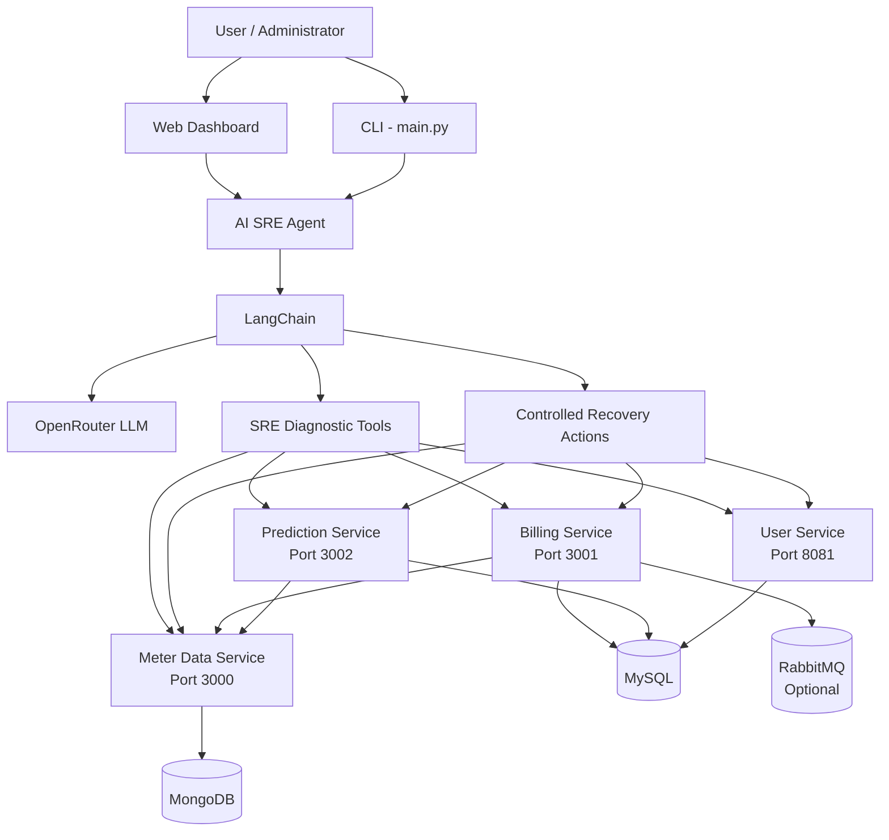

# Smart Electricity AI SRE Incident & Auto-Recovery Agent

An Agentic AI-based Site Reliability Engineering platform built on top of a real Smart Electricity microservice system.

The project combines a distributed electricity management application with an AI SRE agent capable of monitoring services, investigating failures, analyzing logs and dependencies, verifying database connectivity, and automatically recovering stopped services.

The system also includes a minimal web dashboard designed to demonstrate the complete microservice environment and AI recovery workflow.

---

# 1. Project Overview

The project originally contains a Smart Electricity System consisting of multiple independent microservices.

The services handle:

- Electricity meter readings
- User management
- Electricity billing
- Electricity consumption prediction

An AI SRE layer was then added around the existing microservice environment.

The AI SRE agent is able to inspect the real system instead of answering using only general knowledge.

It has controlled tools for:

- HTTP health checking
- TCP port diagnosis
- Application log analysis
- Dependency analysis
- MySQL authentication testing
- Database query verification
- Controlled service startup
- Automatic service recovery

The final project therefore demonstrates both:

1. A working Smart Electricity microservice system
2. An Agentic AI-based SRE monitoring and recovery system

---

# 2. Main Project Objective

The main objective is to demonstrate how Agentic AI can assist with real Site Reliability Engineering tasks.

Normally, when a microservice fails, an administrator may need to manually:

```text
Check whether the API responds
        ↓
Check whether the process is running
        ↓
Check the TCP port
        ↓
Read application logs
        ↓
Check databases
        ↓
Check dependent services
        ↓
Determine the probable cause
        ↓
Restart the service
        ↓
Verify recovery
```

In this project the user can instead ask:

```text
Investigate the whole system
```

The AI SRE agent can decide which tools are required and perform the investigation automatically.

---

# 3. Main Features

## Smart Electricity System

- Meter data collection
- User management
- Electricity bill generation
- Electricity usage prediction
- MySQL database integration
- MongoDB integration
- Optional RabbitMQ messaging
- REST API communication between microservices

## AI SRE System

- Service discovery
- HTTP health monitoring
- Response-time measurement
- TCP port diagnosis
- Application log inspection
- Log sanitization
- Dependency checking
- Required/optional dependency awareness
- Real MySQL authentication testing
- SQL query verification
- AI root-cause reasoning
- Controlled automatic service recovery
- Post-recovery verification
- Interactive CLI
- Web dashboard

## Showcase Dashboard

- Overall system health
- Microservice descriptions
- Technology stack information
- Database information
- Live service status
- Response times
- Start service
- Stop service
- View logs
- View dependencies
- MySQL database verification
- Live electricity bills
- Live predictions
- Meter readings
- Users
- AI SRE Agent interface
- Automatic incident recovery demonstration

---

# 4. System Architecture



---

# 5. Smart Electricity Microservices

The system contains four main microservices.

| Service | Technology | Port | Database | Purpose |
|---|---|---:|---|---|
| Meter Data Service | Node.js / Express | 3000 | MongoDB | Stores electricity usage readings |
| Billing Service | Node.js / Express | 3001 | MySQL | Generates electricity bills |
| Prediction Service | Node.js / Express | 3002 | MySQL | Predicts future electricity consumption |
| User Service | Spring Boot | 8081 | MySQL | Manages users and customers |

---

# 6. Microservice Responsibilities

## Meter Data Service

Port:

```text
3000
```

Technology:

```text
Node.js
Express
MongoDB
```

Main responsibility:

Stores electricity consumption measurements for meters.

Important endpoints include:

```text
GET  /health

POST /api/usage
GET  /api/usage
GET  /api/usage/:id

GET /api/usage/user/:userId
GET /api/usage/history/:meterId

GET /api/usage/monthly/:meterId/:year/:month
```

Example meter reading:

```json
{
  "meterId": "1",
  "userId": "1",
  "readingValue": 220,
  "date": "2026-03-15T10:00:00Z"
}
```

The Billing and Prediction services depend on Meter Data Service.

---

## Billing Service

Port:

```text
3001
```

Technology:

```text
Node.js
Express
MySQL
```

Database:

```text
billing_db
```

Main responsibility:

Generates electricity bills using meter consumption information.

Important endpoints:

```text
POST /api/generate
GET  /api/bills
GET  /api/bill/:id
```

Billing Service communicates with Meter Data Service to obtain electricity usage information.

It also has RabbitMQ integration.

RabbitMQ is currently treated as an optional dependency.

If RabbitMQ is unavailable, Billing can continue without messaging.

---

## Prediction Service

Port:

```text
3002
```

Technology:

```text
Node.js
Express
MySQL
```

Database:

```text
prediction_db
```

Main responsibility:

Predicts future electricity usage.

Important endpoints:

```text
GET  /api/predictions
POST /api/predict
```

Example:

```json
{
  "meter_id": "1",
  "month": 4,
  "year": 2026
}
```

Prediction Service retrieves historical usage data from Meter Data Service.

When enough readings are available, prediction uses a simple linear-regression approach.

---

## User Service

Port:

```text
8081
```

Technology:

```text
Java
Spring Boot
MySQL
```

Database:

```text
user_db
```

Main endpoints:

```text
POST   /api/users
POST   /api/users/login

GET    /api/users
GET    /api/users/{id}

PUT    /api/users/{id}
DELETE /api/users/{id}

GET    /api/users/health
```

User Service manages customers and system users.

---

# 7. Dependency Architecture

The current runtime dependency structure is:

```text
Meter Data Service
        │
        └── MongoDB
            Port 27017


Billing Service
        │
        ├── MySQL
        │   Port 3306
        │
        ├── Meter Data Service
        │   Port 3000
        │
        └── RabbitMQ
            Port 5672
            OPTIONAL


Prediction Service
        │
        ├── MySQL
        │   Port 3306
        │
        └── Meter Data Service
            Port 3000


User Service
        │
        └── MySQL
            Port 3306
```

---

# 8. AI SRE Architecture

The AI layer is separated from the microservices.

```text
User
 ↓
SRE Agent
 ↓
LangChain
 ↓
LLM
 ↓
Tool Selection
 ↓
Python Diagnostic Tool
 ↓
Real System
 ↓
Evidence
 ↓
LLM Reasoning
 ↓
Incident Report / Recovery
```

The LLM itself does not directly access operating-system resources.

Instead, only selected tools are exposed to the AI.

This creates a controlled Agentic AI environment.

---

# 9. Project Structure

```text
electricity prediction system with agents/
│
├── main.py
│
├── dashboard.py
│
├── Makefile
│
├── requirements.txt
│
├── .env
│
├── .env.example
│
├── .gitignore
│
│
├── agent/
│   │
│   ├── __init__.py
│   ├── tools.py
│   ├── langchain_tools.py
│   ├── llm.py
│   ├── sre_agent.py
│   └── actions.py
│
├── scripts/
│   │
│   └── run_service.py
│
├── showcase/
│   │
│   ├── templates/
│   │   └── index.html
│   │
│   └── static/
│       ├── style.css
│       └── app.js
│
├── logs/
│   │
│   ├── meter-data-service.log
│   ├── billing-service.log
│   ├── prediction-service.log
│   └── user-service.log
│
├── runtime/
│   │
│   ├── meter-data-service.pid
│   ├── billing-service.pid
│   ├── prediction-service.pid
│   └── user-service.pid
│
├── config/
│
├── tests/
│
└── sources/
    │
    └── smart-electricity-system/
        │
        ├── meter-data-service/
        │
        ├── billing-service/
        │
        ├── prediciton-service/
        │   └── prediction-service/
        │
        └── user-service/
```

Note:

The folder name:

```text
prediciton-service
```

contains the original spelling used in the existing project structure.

---

# 10. Important Project Files

## `main.py`

Main command-line interface for the SRE Agent.

Run:

```bash
python main.py
```

Example:

```text
============================================================
AI SRE Incident Agent
============================================================

You: Investigate the whole system
```

The user request is sent to the AI SRE Agent.

---

## `dashboard.py`

Flask web application used for the showcase interface.

It connects the frontend with:

- Service health checks
- Logs
- Dependencies
- MySQL checks
- Start actions
- Stop actions
- Electricity system data
- AI SRE Agent

Run:

```bash
python dashboard.py
```

Then open:

```text
http://127.0.0.1:5000
```

---

## `agent/tools.py`

Contains deterministic SRE diagnostic functions.

These functions perform actual system checks.

Examples include:

```text
HTTP request
TCP socket connection
Read service logs
Dependency checks
MySQL authentication
SELECT 1 database test
```

The functions themselves do not use AI.

This means the evidence collected by the system is deterministic.

---

## `agent/langchain_tools.py`

Wraps the Python diagnostic functions as LangChain tools.

Example:

```python
@tool
def sre_check_service(service_name: str):
    ...
```

This allows the LLM to decide when a diagnostic function should be used.

---

## `agent/llm.py`

Configures the LLM connection.

The current project uses:

```text
OpenRouter
```

through:

```text
langchain-openrouter
```

Example environment configuration:

```env
OPENROUTER_API_KEY=YOUR_KEY
SRE_MODEL=openrouter/free
```

---

## `agent/sre_agent.py`

Contains the main AI SRE reasoning agent.

The system prompt defines:

- Investigation procedure
- Dependency interpretation
- Database interpretation
- Root-cause reasoning rules
- Recovery rules
- Safety rules
- Final incident report format

The LangChain agent combines:

```text
LLM
+
SRE tools
+
Recovery tool
+
SRE instructions
```

---

## `agent/actions.py`

Contains controlled service actions.

Current actions include:

```text
start_service()
stop_service()
```

The start action can be exposed to the AI.

The stop action is intended primarily for manual demonstration from the dashboard.

The AI is not given unrestricted shell-command access.

---

## `scripts/run_service.py`

Starts microservices while capturing application output.

Instead of:

```text
node app.js
```

directly, the project uses:

```text
python scripts/run_service.py billing
```

The service console output is:

```text
displayed in terminal
+
saved into logs/
```

The service runner also stores process IDs under:

```text
runtime/
```

This allows the dashboard to safely stop services that were launched by the project.

---

# 11. Service Logging

Logs are stored in:

```text
logs/
```

Example:

```text
logs/billing-service.log
```

A typical log may contain:

```text
Billing Service running on port 3001
Billing DB connected
RabbitMQ connection failed, starting without messaging
```

The SRE Agent can inspect recent logs during an incident.

---

# 12. Log Sanitization

Sensitive values should not be sent directly to the LLM.

The logging tool attempts to redact values such as:

```text
password
api_key
authorization
token
```

Example:

```text
password=mysecretpassword
```

becomes:

```text
password=***REDACTED***
```

The configured MySQL password is also removed from returned log text when detected.

---

# 13. AI SRE Tools

The AI currently has the following tools.

| Tool | Purpose |
|---|---|
| `sre_list_services` | Lists configured services |
| `sre_check_service` | HTTP health check |
| `sre_diagnose_service` | Checks service TCP port |
| `sre_get_service_logs` | Reads recent sanitized logs |
| `sre_check_dependencies` | Checks dependencies |
| `sre_check_mysql_database` | Real MySQL connection/query test |
| `sre_start_service` | Controlled automatic recovery |

---

# 14. Tool: `sre_list_services`

Returns the services known to the monitoring system.

Example:

```json
{
  "services": [
    "meter-data-service",
    "billing-service",
    "prediction-service",
    "user-service"
  ]
}
```

The agent normally calls this during a whole-system investigation.

---

# 15. Tool: `sre_check_service`

Performs an HTTP request to the service.

Example:

```text
sre_check_service("billing-service")
```

Possible results:

```text
healthy
unhealthy
unreachable
error
```

Example:

```json
{
  "service": "billing-service",
  "status": "healthy",
  "url": "http://localhost:3001/api/bills",
  "http_status": 200,
  "response_time_ms": 8.24
}
```

---

# 16. Tool: `sre_diagnose_service`

Checks whether the application's TCP port is open.

Example:

```text
billing-service
Port 3001
```

If open:

```text
process appears to be listening
```

If closed:

```text
service may be stopped or crashed
```

This allows the agent to distinguish between:

```text
process unavailable
```

and:

```text
application responding incorrectly
```

---

# 17. Tool: `sre_get_service_logs`

Reads recent logs for a selected service.

Example:

```text
sre_get_service_logs(
    "billing-service",
    80
)
```

The maximum log amount is intentionally limited.

This prevents unnecessary large log payloads being sent to the LLM.

---

# 18. Tool: `sre_check_dependencies`

Checks dependencies defined for each service.

Example Billing result:

```text
MySQL                 Available      Required
Meter Data Service    Healthy        Required
RabbitMQ               Unavailable    Optional
```

This allows the agent to understand that:

```text
RabbitMQ unavailable
```

does not automatically mean:

```text
Billing cannot run
```

---

# 19. Required and Optional Dependencies

The dependency checker separates dependencies into:

```text
Required
```

and:

```text
Optional
```

A failed required dependency can prevent a service from functioning.

A failed optional dependency should not automatically be treated as the root cause.

Example:

```text
RabbitMQ connection failed, starting without messaging
```

means:

```text
RabbitMQ is unavailable
```

but also:

```text
Billing explicitly continued startup
```

Therefore the AI should not incorrectly blame RabbitMQ for every Billing outage.

---

# 20. Tool: `sre_check_mysql_database`

A TCP port check does not prove that a database actually works.

For example:

```text
3306 open
```

only proves that something is accepting connections.

It does not prove:

```text
username works
password works
database exists
queries work
```

The MySQL diagnostic performs:

```text
Connect to MySQL
       ↓
Authenticate
       ↓
Open service database
       ↓
Execute SELECT 1
       ↓
Return result
```

Example successful result:

```json
{
  "service": "billing-service",
  "database_type": "mysql",
  "database": "billing_db",
  "host": "localhost",
  "port": 3306,
  "status": "success",
  "authentication": "success",
  "database_access": "success",
  "query_test": "success",
  "response_time_ms": 163.47
}
```

---

# 21. Tool: `sre_start_service`

Provides controlled automatic recovery.

The LLM cannot execute arbitrary Windows commands.

Instead, it can only request:

```text
sre_start_service("billing-service")
```

for approved services.

The tool checks:

```text
Is service already healthy?
        ↓

Is its port already open?
        ↓

Is duplicate startup possible?
        ↓

Start using controlled runner
        ↓

Wait for startup
        ↓

Perform health check
```

---

# 22. Automatic Recovery Flow

Example incident:

```text
Billing Service
     ↓
HTTP unreachable
     ↓
Port 3001 closed
     ↓
Read Billing logs
     ↓
Check dependencies
     ↓
MySQL authentication succeeds
     ↓
Meter Data Service healthy
     ↓
RabbitMQ unavailable but optional
     ↓
Safe to start Billing
     ↓
AI invokes sre_start_service
     ↓
Billing starts
     ↓
HTTP health check
     ↓
200 OK
```

The final report can state:

```text
Automatic recovery succeeded.
```

---

# 23. Recovery Safety Rules

The agent should not repeatedly restart services without evidence.

Automatic startup is allowed when:

1. The service is unhealthy or unreachable.
2. The service port is closed.
3. The process appears to be stopped.
4. Required dependencies are available.
5. No obvious blocking database problem is present.

The agent performs only one automatic recovery attempt per affected service during an investigation.

If recovery fails, the AI should report the failure instead of creating a restart loop.

---

# 24. Manual Stop for Demonstration

The web dashboard includes:

```text
Stop Service
```

This is useful for demonstrating the project.

Example:

```text
Billing Service
Healthy
     ↓
Click Stop Service
     ↓
Billing becomes Unreachable
     ↓
AI Agent → Detect & Recover
     ↓
AI investigates
     ↓
Billing starts automatically
     ↓
Billing returns to Healthy
```

The stop action is restricted to processes managed by this project's service runner.

The dashboard should not terminate arbitrary processes.

---

# 25. Web Showcase Dashboard

The dashboard is intentionally minimal.

The page contains the following sections.

## System Overview

Displays:

```text
Services
Healthy services
Incidents
Auto Recovery status
```

---

## Microservices

Each service card explains:

```text
Service name
Purpose
Technology
Database
Port
Current health
Response time
```

Available actions include:

```text
Logs
Dependencies
DB Test
Stop Service
Start Service
```

---

## Live System Data

Displays real data returned from the microservice APIs.

Sections include:

```text
Bills
Predictions
Meter Readings
Users
```

This allows viewers to understand that the SRE Agent is monitoring a real application instead of a simulated service environment.

---

## AI SRE Agent

Provides quick actions:

```text
Investigate System

Detect & Recover

Check Billing
```

Users can also type custom questions.

Example:

```text
Why is billing-service unavailable?
```

---

## Agent Tools

The dashboard also explains the agent capabilities:

```text
HTTP Health
TCP Diagnosis
Log Analysis
Dependency Checking
MySQL Verification
Auto Recovery
```

---

# 26. AI Investigation Flow

```text
Detect
  ↓
Diagnose
  ↓
Analyze
  ↓
Recover
  ↓
Verify
```

More specifically:

```text
Check HTTP
    ↓
Check port
    ↓
Read logs
    ↓
Check dependencies
    ↓
Verify MySQL
    ↓
Determine cause
    ↓
Perform safe recovery
    ↓
Verify service
```

---

# 27. Evidence-Based Reasoning

The AI is instructed to distinguish between three levels of confidence.

## Fact

Directly observed.

Example:

```text
Port 3001 is closed.
```

## Supported Conclusion

Strongly supported by evidence.

Example:

```text
Billing Service is not currently running.
```

## Possible Cause

Plausible but not confirmed.

Example:

```text
The process may have crashed.
```

The AI should never present speculation as a confirmed root cause.

---

# 28. Example Incident Report

```text
Evidence:

- billing-service is unreachable.
- Port 3001 is closed.
- Logs show that Billing previously started successfully.


Dependency Status:

- MySQL authentication succeeded.
- billing_db access succeeded.
- SELECT 1 succeeded.
- meter-data-service is healthy.
- RabbitMQ is unavailable but optional.


Likely Cause:

Billing Service is currently not running.

The exact reason the process stopped cannot be confirmed
from the available evidence.


Recovery Action:

billing-service was automatically started.


Final Status:

billing-service returned HTTP 200.

Automatic recovery succeeded.

All monitored services are currently healthy.
```

---

# 29. Why This Is Agentic AI

A traditional monitoring script follows a predefined sequence.

Example:

```python
if billing_down:
    check_port()
    read_logs()
```

In this project the LLM is given tools.

The agent decides which tool should be called next based on previous results.

Example:

```text
AI checks Billing
      ↓
Billing unreachable
      ↓
AI decides to check port
      ↓
Port closed
      ↓
AI decides to read logs
      ↓
AI checks dependencies
      ↓
AI checks MySQL
      ↓
AI decides recovery is safe
      ↓
AI starts Billing
```

This dynamic reasoning and tool selection makes the system Agentic AI.

---

# 30. Technologies Used

| Technology | Purpose |
|---|---|
| Python | SRE agent and dashboard backend |
| Flask | Web showcase dashboard |
| LangChain | AI agent/tool orchestration |
| OpenRouter | LLM provider |
| Node.js | Meter, Billing and Prediction services |
| Express.js | REST APIs |
| Spring Boot | User Service |
| MySQL | Billing, Prediction and User databases |
| MongoDB | Meter readings |
| RabbitMQ | Optional messaging |
| Requests | HTTP service checks |
| Python Socket | TCP diagnostics |
| mysql-connector-python | MySQL verification |
| python-dotenv | Environment configuration |
| psutil | Controlled process management |
| GNU Make | Development service launcher |

---

# 31. Requirements

Recommended Python packages:

```text
requests>=2.32,<3
python-dotenv>=1.0,<2
langchain>=1.0,<2
langchain-openrouter>=0.1
mysql-connector-python>=9.0
flask>=3.1,<4
psutil>=7.0
```

A clean `requirements.txt` does not need to contain every transitive dependency installed by `pip`.

---

# 32. Prerequisites

Recommended development environment:

```text
Windows
Python 3
Node.js
npm
Java 17
Maven
MySQL
MongoDB
GNU Make
```

RabbitMQ is optional for the current Billing implementation.

---

# 33. Python Environment Setup

From the project directory:

```bat
cd /d "E:\CeyTech Labs\electricity prediction system with agents"
```

Create a virtual environment:

```bat
python -m venv .venv
```

Activate it:

```bat
.venv\Scripts\activate
```

Install Python packages:

```bat
pip install -r requirements.txt
```

---

# 34. Environment Configuration

Create:

```text
.env
```

Example:

```env
# ============================================================
# MICROSERVICES
# ============================================================

METER_SERVICE_URL=http://localhost:3000

BILLING_SERVICE_URL=http://localhost:3001

PREDICTION_SERVICE_URL=http://localhost:3002

USER_SERVICE_URL=http://localhost:8081


# ============================================================
# MYSQL
# ============================================================

MYSQL_HOST=localhost

MYSQL_PORT=3306

MYSQL_USER=meteruser

MYSQL_PASSWORD=YOUR_LOCAL_MYSQL_PASSWORD


# ============================================================
# MONGODB
# ============================================================

MONGODB_HOST=localhost

MONGODB_PORT=27017


# ============================================================
# RABBITMQ
# ============================================================

RABBITMQ_HOST=localhost

RABBITMQ_PORT=5672


# ============================================================
# OPENROUTER
# ============================================================

OPENROUTER_API_KEY=YOUR_OPENROUTER_API_KEY

SRE_MODEL=openrouter/free
```

Never commit the real `.env` file.

---

# 35. Recommended `.env.example`

The repository should contain:

```text
.env.example
```

Example:

```env
METER_SERVICE_URL=http://localhost:3000
BILLING_SERVICE_URL=http://localhost:3001
PREDICTION_SERVICE_URL=http://localhost:3002
USER_SERVICE_URL=http://localhost:8081

MYSQL_HOST=localhost
MYSQL_PORT=3306
MYSQL_USER=your_mysql_user
MYSQL_PASSWORD=your_mysql_password

MONGODB_HOST=localhost
MONGODB_PORT=27017

RABBITMQ_HOST=localhost
RABBITMQ_PORT=5672

OPENROUTER_API_KEY=your_openrouter_key
SRE_MODEL=openrouter/free
```

---

# 36. MySQL Databases

The project uses:

```text
billing_db
prediction_db
user_db
```

Example:

```sql
SHOW DATABASES;
```

Expected databases should include:

```text
billing_db
prediction_db
user_db
```

---

# 37. Billing Database Example

```sql
CREATE DATABASE IF NOT EXISTS billing_db;

USE billing_db;
```

Example bills table:

```sql
CREATE TABLE IF NOT EXISTS bills
(
    bill_id INT AUTO_INCREMENT PRIMARY KEY,

    meter_id INT NOT NULL,

    billing_month INT NOT NULL,

    billing_year INT NOT NULL,

    units_consumed DOUBLE NOT NULL,

    rate_per_unit DOUBLE NOT NULL,

    total_amount DOUBLE NOT NULL,

    status VARCHAR(50) DEFAULT 'GENERATED',

    created_at TIMESTAMP DEFAULT CURRENT_TIMESTAMP
);
```

---

# 38. Demo Billing Data

Example demonstration data:

```sql
USE billing_db;

INSERT INTO bills
(
    meter_id,
    billing_month,
    billing_year,
    units_consumed,
    rate_per_unit,
    total_amount,
    status
)
VALUES
(
    1,
    1,
    2026,
    180,
    27.33,
    7020.00,
    'GENERATED'
),
(
    1,
    2,
    2026,
    200,
    31.00,
    8240.00,
    'GENERATED'
),
(
    1,
    3,
    2026,
    220,
    35.50,
    10100.00,
    'GENERATED'
);
```

These values are demonstration records and are not intended as official electricity tariff calculations.

---

# 39. Demo User Data

First inspect the actual User Service schema:

```sql
USE user_db;

SHOW TABLES;
```

Then:

```sql
DESCRIBE users;
```

If the table structure contains:

```text
id
name
email
password
role
```

demo data can be inserted.

For demonstration environments only:

```sql
INSERT INTO users
(
    name,
    email,
    password,
    role
)
VALUES
(
    'Demo Customer',
    'demo.customer@example.com',
    'demo123',
    'customer'
),
(
    'System Admin',
    'admin.demo@example.com',
    'demo123',
    'admin'
);
```

Do not use real passwords in demo data.

Using the User Service API is preferable because it exercises the actual application logic.

Example:

```bat
curl -X POST http://localhost:8081/api/users ^
-H "Content-Type: application/json" ^
-d "{\"name\":\"Demo Customer\",\"email\":\"demo.customer@example.com\",\"password\":\"demo123\",\"role\":\"customer\"}"
```

---

# 40. Demo Meter Data

Meter Data Service uses MongoDB.

Use the API to create readings.

January:

```bat
curl -X POST http://localhost:3000/api/usage ^
-H "Content-Type: application/json" ^
-d "{\"meterId\":\"1\",\"userId\":\"1\",\"readingValue\":180,\"date\":\"2026-01-15T10:00:00Z\"}"
```

February:

```bat
curl -X POST http://localhost:3000/api/usage ^
-H "Content-Type: application/json" ^
-d "{\"meterId\":\"1\",\"userId\":\"1\",\"readingValue\":200,\"date\":\"2026-02-15T10:00:00Z\"}"
```

March:

```bat
curl -X POST http://localhost:3000/api/usage ^
-H "Content-Type: application/json" ^
-d "{\"meterId\":\"1\",\"userId\":\"1\",\"readingValue\":220,\"date\":\"2026-03-15T10:00:00Z\"}"
```

Check history:

```bat
curl http://localhost:3000/api/usage/history/1
```

---

# 41. Generate Prediction Data

Instead of manually inserting prediction records, use the Prediction Service.

Example:

```bat
curl -X POST http://localhost:3002/api/predict ^
-H "Content-Type: application/json" ^
-d "{\"meter_id\":\"1\",\"month\":4,\"year\":2026}"
```

Then:

```bat
curl http://localhost:3002/api/predictions
```

This demonstrates the real Prediction Service rather than static database data.

---

# 42. Generate Billing Data Through API

Use:

```bat
curl -X POST http://localhost:3001/api/generate ^
-H "Content-Type: application/json" ^
-d "{\"meter_id\":\"1\",\"month\":3,\"year\":2026,\"user_id\":1}"
```

Check bills:

```bat
curl http://localhost:3001/api/bills
```

---

# 43. Start All Services

From the project root:

```bat
make start
```

The service runner launches:

```text
Meter Data Service
Billing Service
Prediction Service
User Service
```

The output is also stored in:

```text
logs/
```

---

# 44. Individual Service Commands

Examples:

```bat
make meter
```

```bat
make billing
```

```bat
make prediction
```

```bat
make user
```

---

# 45. Start the CLI Agent

Run:

```bat
python main.py
```

Examples:

```text
Investigate the whole system
```

```text
Check billing-service
```

```text
Why is prediction-service unavailable?
```

```text
Find incidents and recover stopped services
```

---

# 46. Start the Web Dashboard

Run:

```bat
python dashboard.py
```

Open:

```text
http://127.0.0.1:5000
```

---

# 47. Recommended Showcase Demonstration

For a presentation, begin with all services healthy.

The dashboard should show:

```text
Meter Data Service    Healthy
Billing Service       Healthy
Prediction Service    Healthy
User Service          Healthy
```

Live data should also appear:

```text
Bills
Predictions
Meter Readings
Users
```

Then demonstrate an incident.

### Step 1

Click:

```text
Stop Service
```

for Billing.

### Step 2

Billing becomes:

```text
Unreachable
```

The Bills area also becomes unavailable because its service has stopped.

### Step 3

Scroll to:

```text
AI SRE Incident Agent
```

Click:

```text
Detect & Recover
```

### Step 4

The AI should investigate:

```text
Billing HTTP
      ↓
Port 3001
      ↓
Logs
      ↓
Dependencies
      ↓
MySQL
      ↓
Recovery decision
```

### Step 5

The AI automatically starts Billing.

### Step 6

Billing becomes:

```text
Healthy
```

again.

The Bills data should also return.

This demonstrates that the SRE Agent is controlling and inspecting the same real microservice system shown on the dashboard.

---

# 48. Manual Health Mode

The CLI also supports deterministic monitoring without using the LLM.

Example:

```text
health
```

This is useful for showing the difference between:

```text
traditional deterministic monitoring
```

and:

```text
AI-based incident reasoning
```

---

# 49. OpenRouter

The current LLM is accessed through OpenRouter.

Advantages include:

- Multiple available LLM providers
- Easy model switching
- LangChain integration
- Free model options for development

The model can be changed through:

```env
SRE_MODEL=openrouter/free
```

without rewriting the SRE diagnostic functions.

---

# 50. LangChain's Role

LangChain connects the LLM with the SRE tools.

Example:

```text
LLM:

"I need to check Billing."

        ↓

LangChain tool call

        ↓

sre_check_service("billing-service")

        ↓

Python performs real HTTP request

        ↓

Result returned to LLM
```

This creates controlled tool-based reasoning.

---

# 51. Security Design

The AI does not receive unrestricted operating-system access.

It cannot arbitrarily execute:

```text
del
format
net stop
taskkill
SQL DELETE
filesystem modifications
```

unless a specific controlled tool is deliberately created.

Current automatic action is limited to approved service startup.

The dashboard has controlled start/stop actions for demonstration.

---

# 52. Sensitive Information

Never commit:

```text
.env
API keys
database passwords
tokens
production credentials
```

Never store real secrets in source code.

---

# 53. Recommended `.gitignore`

```gitignore
# Environment
.env

# Python
.venv/
venv/
__pycache__/
*.pyc
*.pyo
.pytest_cache/

# Runtime
runtime/
*.pid

# Logs
logs/
*.log

# Node
node_modules/

# Maven / Java
target/

# IDE
.vscode/
.idea/

# OS
.DS_Store
Thumbs.db
```

---

# 54. Important Development Security Note

The current Smart Electricity project is intended as a development and demonstration environment.

Demo users should use fake passwords only.

Before using the system in a real production environment, authentication should be upgraded to use secure password hashing and stronger access control.

---

# 55. Current Limitations

The current version does not yet include:

- Kubernetes monitoring
- Docker orchestration
- CPU metrics
- RAM metrics
- Disk monitoring
- Historical incident database
- Persistent AI conversation memory
- Slack alerts
- Email alerts
- SMS alerts
- Full MongoDB authentication diagnostics
- RabbitMQ authentication diagnostics
- Multi-host monitoring
- Production-grade RBAC
- Automatic scaling

These are optional future improvements.

---

# 56. Future Improvements

Possible future features include:

```text
Incident history
        ↓
Incident severity classification
        ↓
CPU / Memory / Disk monitoring
        ↓
Prometheus metrics
        ↓
Grafana dashboard
        ↓
Docker monitoring
        ↓
Kubernetes monitoring
        ↓
Slack notifications
        ↓
Email alerts
        ↓
Human-approved remediation
        ↓
AI root-cause confidence score
```

---

# 57. Possible Future LangGraph Architecture

```text
Incident Detected
        ↓
Health Check Node
        ↓
Port Diagnosis Node
        ↓
Log Analysis Node
        ↓
Dependency Node
        ↓
Database Verification Node
        ↓
Root Cause Node
        ↓
Recovery Decision
      ↙       ↘
   Unsafe      Safe
     ↓           ↓
   Report     Recovery
                 ↓
              Verify
                 ↓
              Report
```

This could make the investigation process more deterministic while still retaining LLM reasoning.

---

# 58. Project Evolution

The project began as:

```text
Smart Electricity Prediction System
```

and was extended into:

```text
Smart Electricity
+
Microservices
+
Agentic AI
+
Site Reliability Engineering
+
Automatic Incident Recovery
```

The main contribution of the final project is therefore not only electricity prediction.

It demonstrates how an AI agent can interact safely with a real distributed application and assist with system reliability.

---

# 59. Current Project Status

## Smart Electricity Platform

```text
✅ Meter Data Service
✅ Billing Service
✅ Prediction Service
✅ User Service
✅ MySQL
✅ MongoDB
✅ Inter-service communication
```

## SRE Monitoring

```text
✅ Service discovery
✅ HTTP health checking
✅ Response-time monitoring
✅ TCP port checking
✅ Log collection
✅ Log analysis
✅ Dependency checking
✅ Required / optional dependency awareness
```

## Database Diagnostics

```text
✅ MySQL network verification
✅ Authentication verification
✅ Database access verification
✅ SELECT 1 verification
```

## Agentic AI

```text
✅ OpenRouter
✅ LangChain
✅ Tool calling
✅ Evidence-based reasoning
✅ Root-cause assistance
✅ Dynamic investigation flow
```

## Recovery

```text
✅ Controlled service start
✅ Service stop for demonstrations
✅ Duplicate-process protection
✅ Dependency-aware recovery
✅ Post-recovery health verification
```

## User Interface

```text
✅ Minimal web dashboard
✅ Microservice explanation
✅ Live service status
✅ Logs
✅ Dependencies
✅ Database tests
✅ Live Bills
✅ Live Predictions
✅ Live Meter Readings
✅ Live Users
✅ AI Agent interface
✅ Start / Stop controls
```

---

# 60. Project Demo Flow

The complete presentation can be summarized as:

```text
Real Smart Electricity System
          ↓
Four Microservices
          ↓
Real Databases
          ↓
Real API Data
          ↓
AI SRE Agent
          ↓
Detect Incident
          ↓
Investigate
          ↓
Analyze Evidence
          ↓
Automatically Recover
          ↓
Verify Health
```

---

# 61. Project Summary

This project demonstrates a practical Agentic AI approach to Site Reliability Engineering.

Rather than allowing an LLM to guess infrastructure conditions:

```text
Python collects real evidence
        ↓
LangChain exposes safe tools
        ↓
AI chooses investigation steps
        ↓
LLM correlates evidence
        ↓
Controlled recovery is performed
        ↓
Recovery is verified
        ↓
Human receives an incident report
```

The result is a working prototype of an:

# AI SRE Incident & Auto-Recovery Agent

for a real microservice-based Smart Electricity System.

---

# 62. Author

GitHub:

```text
Nadula-W
```

Repository:

```text
electricity-prediction-system-with-agents
```

---

# 63. Project Stage

**Version 1 — Functional Agentic AI SRE Prototype**

Current focus:

```text
Microservice monitoring
Incident investigation
Dependency analysis
Log analysis
Database diagnostics
AI reasoning
Controlled automatic recovery
Web-based project demonstration
```

---

## License

This project is intended for academic, educational and portfolio demonstration purposes.

Third-party libraries and original microservice components remain subject to their respective licenses.